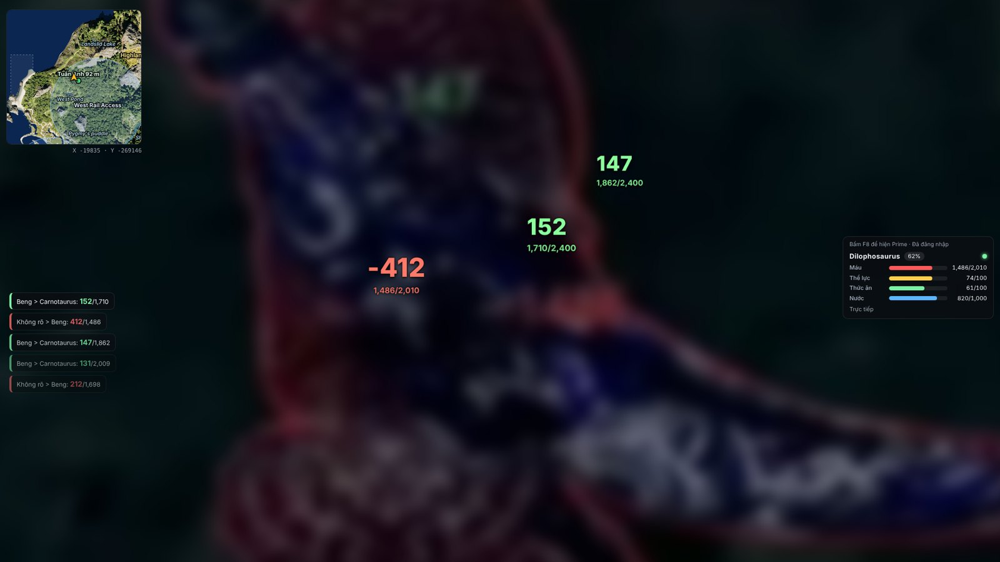
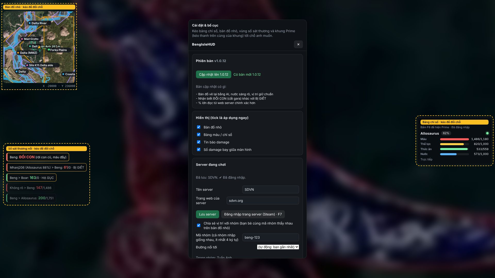

# BengIsleHUD

HUD tiếng Việt cho **The Isle (Evrima)** trên Windows: bảng chỉ số khủng long, bản đồ nhỏ theo thời gian thực, nhật ký cắn / bị cắn, số damage bay, bảng Prime của server và vị trí nhóm.

HUD **chỉ đọc gói tin mạng** của game (qua Npcap). Không gửi gì vào game, không chỉnh sửa game, không đọc bộ nhớ game.

> Repo này chỉ chứa **bộ cài** và dữ liệu tự cập nhật, không có mã nguồn.

## Bản mới nhất: 1.0.9 (10/11/2026)

**Khác bản 1.0.8** (nội dung này cũng hiện trong F9 > Phiên bản):

- **F4 > bảng Lớp bản đồ** giống sdvn: Địa điểm, Khu bảo tồn, Vùng di cư, Vùng tuần tra AI, Nguồn nước, Công trình, Vũng bùn, có số lượng và nút bật / tắt.
- Bấm › để xem danh sách tên, bấm một tên là bản đồ chạy tới chỗ đó.

**[Tải BengIsleHUD-Setup-1.0.9.exe](https://github.com/dathdlsinc/bengislehud-releases/releases/latest)**: vào trang Release, mục *Assets*. Đang dùng bản cài thì chỉ cần F9 > Phiên bản > "Cập nhật lên 1.0.9".

## Hình ảnh

Đang đánh nhau: bản đồ nhỏ (trái trên), nhật ký cắn / bị cắn (trái), số damage bay (giữa), bảng chỉ số (phải):



Có bản mới: 2 dòng nhỏ ở trên cùng màn hình, không che game:


F9: cài đặt, kéo thả các bảng, mục Phiên bản có nút cập nhật và nội dung bản mới:



## Cài (1 lần, khoảng 3 phút)

1. **Cài BengIsleHUD**: chạy `BengIsleHUD-Setup-x.y.z.exe`.
   - Nếu Windows hiện *"Windows protected your PC"*: bấm **More info > Run anyway** (app chưa ký số).
   - App tự cài, có biểu tượng BengIsleHUD ở Desktop và Start Menu. Không cần Python, không cần Wireshark.
2. **Cài Npcap** (driver đọc gói tin):
   - Mở BengIsleHUD, nếu máy chưa có Npcap thì bấm **F9 > Cài Npcap**: app tải bộ cài chính thức từ npcap.com, bấm *Next / I Agree / Install*.
   - Hoặc tự tải ở <https://npcap.com> và cài mặc định. Máy đã có Wireshark thường đã có Npcap.
   - **Không** tick *"Restrict Npcap driver's access to Administrators only"*. Lỡ tick thì cài lại Npcap.

Cài đặt, server đã lưu và đăng nhập nằm ở `%APPDATA%\isle-hud`: cập nhật hay cài lại đều giữ nguyên.

## Cập nhật

- App tự kiểm tra bản mới khi mở và 2 giờ một lần. Có bản mới thì hiện **2 dòng nhỏ ở trên cùng màn hình**, không che game.
- Bấm **F9 > Phiên bản** để xem bản mới có gì, bấm **"Cập nhật lên x.y.z"** khi muốn: app tự tải, tự cài và mở lại.
- Không cập nhật cũng không sao, app vẫn chạy bình thường.

## Chạy mỗi lần chơi

1. Mở BengIsleHUD (nên mở **trước** khi vào server để HUD nhận được tên loài của các con quanh bạn).
2. Mở The Isle, vào server. Sau vài giây HUD tự nhận server và con khủng long của bạn.
3. **Lần đầu vào một server**, bấm **F9**:
   - Mục *Server đang chơi*: nhập tên server và trang web của server (ví dụ `sdvn.org`), bấm **Lưu**.
   - Bấm **F7** để đăng nhập Steam vào trang server. Xong sẽ thấy *"Đã đăng nhập"*.
   - Lần sau vào lại server này, app tự nhận.
4. Bấm F9 lần nữa để đóng cài đặt.

## Phím tắt

| Phím | Việc |
|---|---|
| **F9** | Cài đặt, kéo thả vị trí các bảng, bật / tắt từng phần, cập nhật |
| **F8** | Hiện / ẩn bảng Prime: tab *Prime Quest* và *Pack dino (garage)* |
| **F7** | Đăng nhập Steam vào trang web server |
| **F5** | Đặt điểm hẹn từ toạ độ đã chép (bấm lần nữa để xoá) |
| **F4** | Bản đồ lớn: kéo để xem, +/- để phóng to, chuột phải / đúp chuột hoặc dấu + và Enter để đánh dấu điểm, Esc để đóng |

## Tính năng

- **Bảng khủng long**: tên loài, % Growth (mới vào 25 %, 75 % = lớn tối đa, trên 75 % là Prime), Máu, Thể lực, Thức ăn, Nước; *Chảy máu* chỉ hiện khi đang mất máu. Máu khi đánh nhau khớp nhật ký trận đấu trên web server.
- **Nhật ký cắn / bị cắn** (bên trái): luôn hiện 5 dòng gần nhất, dòng mới ở trên, dòng cũ mờ dần.
  - Bạn cắn: `Tên bạn > Ceratosaurus: damage/máu còn lại`
  - Bị cắn: `Không rõ > Tên bạn: damage/máu còn lại`
  - Khi bạn chết: `... > Tên bạn: máu/0 · BỊ GIẾT`
- **Số damage bay giữa màn hình**: xanh = mình cắn, đỏ = bị cắn, vàng = hạ gục / bị giết; 3 cỡ theo độ nặng của cú; bên dưới là máu còn lại / máu tối đa.
- **Bản đồ nhỏ**: bản đồ Gateway có vùng, tên khu vực; vị trí và hướng của bạn, cả khi bay.
- **Bản đồ lớn (F4)** và **điểm hẹn (F5)**: chép toạ độ bạn gửi (nút copy vị trí trong game), bấm F5: bản đồ có đường chỉ tới và khoảng cách.
- **Vị trí nhóm thời gian thực**: cả nhóm cùng cài HUD, **F9 > tick "Chia sẻ vị trí với nhóm"**, nhập **cùng một mã nhóm** và điền *Tên nhân vật*. Mọi người thấy nhau trên bản đồ nhỏ và bản đồ lớn ở mọi khoảng cách, cập nhật 0,5 giây/lần, tối đa 30 người. Chỉ gửi vị trí con của chính mình, máy chủ không lưu gì.
  - Nên dùng mã nhóm **dài, khó đoán** (ví dụ `beng-ca-heo-7391`), đừng dùng tên server hay `1234`.
- **Bảng Prime (F8)**: trang Prime Quest và Pack dino của web server, mỗi server nhớ riêng.
- Chuột bấm xuyên qua HUD, không vướng khi chơi. Chạy được khi bật hay tắt Cloudflare WARP.

## Chưa có / lưu ý

- Tên kẻ cắn mình từng cú (đang hiện *"Không rõ"*); tên kẻ giết thì có (theo web, cần F7).
- Tên AI (động vật) bị cắn; máu AI đọc được với Boar và Deer (loại AI khác chưa có).
- Server PVN: chưa có máu trước lần đổi đầu tiên, chưa có máu tối đa và thể lực.
- Con đã ở gần bạn trước khi bật HUD có thể chưa có tên loài.
- Bản portable (nếu có) không tự cập nhật, chỉ bản cài mới tự cập nhật.

## Nguồn bản đồ

Ảnh nền Gateway và lớp nước ngọt: [IsleMaps](https://www.islemaps.com) của Pont & Emeara, dùng với sự cho phép của tác giả. Vùng di cư, bảo tồn, tuần tra AI, địa điểm, nguồn nước, công trình, vũng bùn: bản đồ của server [sdvn.org](https://sdvn.org).

## Khi có lỗi

Tắt HUD, mở **PowerShell**, chạy lệnh dưới để chép file log ra Desktop:

```powershell
Copy-Item -Force "$env:APPDATA\isle-hud\logs\isle-hud.log" ([Environment]::GetFolderPath("Desktop"))
```

Gửi file `isle-hud.log` cho Beng, kèm mô tả: đang chơi loài gì, làm gì thì lỗi.

## Nhật ký phiên bản

### 1.0.9 (10/11/2026)
- F4: bảng Lớp bản đồ kiểu sdvn (bật / tắt, số lượng, danh sách tên, bấm để tới).

### 1.0.8 (10/11/2026)
- Vùng, địa điểm, nguồn nước, công trình, vũng bùn theo bản đồ sdvn.org; nhãn kiểu sdvn.
- Đọc trang web sdvn (tiếng Anh): Growth, chỉ số, kẻ giết mình.

### 1.0.7 (10/11/2026)
- Tên trên bản đồ không đè nhau, tên từ IsleMaps; chú thích màu trên F4.
- % Growth, máu / đói / khát theo trang web server (đăng nhập F7).
- Tên và loài kẻ giết mình theo lịch sử chết trên web; báo "có thể là đổi con".

### 1.0.6 (09/11/2026)
- Bản đồ IsleMaps (Pont & Emeara, được phép dùng): vị trí khớp hơn, biển gần đen, nước ngọt, đầm lầy, di cư, bảo tồn.
- Vùng tuần tra AI đỏ nằm trên cùng; F9 bật / tắt từng lớp bản đồ.
- Bỏ báo "ĐỔI CON" (luôn báo BỊ GIẾT).

### 1.0.5 (09/11/2026)
- Mở lại / cập nhật giữa trận vẫn hiện máu và chỉ số ngay.
- (Đã bỏ ở 1.0.6) Đổi con khi máu đầy báo "ĐỔI CON".
- Sửa máu tụt ảo (chỉ số phụ đọc nhầm thành máu).
- Tên AI (Boar, Deer); bắt thêm cú cắn AI bị sót.
- Bỏ máu tối đa sai và số rác khi cắn người chơi khác.

### 1.0.4 (09/11/2026)
- Bản đồ lớn F4 đặt được điểm hẹn (chuột phải, đúp chuột, dấu + và Enter).
- Phím điểm hẹn F6 -> F5; đổi phím trong F9.
- % Growth phần Prime khớp web.

### 1.0.3 (07/11/2026)
- Sửa báo trừ máu sai khi nhảy / khi ăn.
- Sửa % Growth (bắt đầu 25 %).
- Cắn AI: có cú đầu và báo hạ gục.
- Số damage bay kèm máu còn lại / tối đa.
- Báo chết chính xác hơn.
- PVN hiện máu; F8 sửa tab và thẻ Prime trên PVN.

### 1.0.2 (07/11/2026)
- Số damage bay giữa màn hình (3 cỡ, 2 giây; hạ gục / bị giết chữ vàng).
- Báo khi con của bạn chết (cả chết vì chảy máu).
- Vị trí nhóm 0,5 giây/lần, chấm trượt mượt.

### 1.0.1 (06/11/2026)
- Có bản mới: chỉ hiện 2 dòng nhỏ ở trên cùng màn hình, không còn thông báo to giữa màn hình khi đang chơi.
- F9 > Phiên bản: hiện nội dung bản cập nhật, cài khi muốn.
- Nhật ký cắn / bị cắn đứng yên trên màn hình (5 dòng gần nhất), không tự biến mất.

### 1.0.0 (06/11/2026)
- Bản cài đầu tiên, có tự cập nhật.
- Máu khi đánh nhau khớp nhật ký web; tên loài con bị cắn; máu AI (Boar, Deer); % Growth.
- F4 bản đồ lớn, F6 điểm hẹn, F7 đăng nhập Steam, F8 Prime / Pack dino, F9 cài đặt.
- Vị trí nhóm thời gian thực.
